# 01. Contexto de Tesis y Distribución de Roles

## 1. Información General del Proyecto Académico

- **Institución:** Instituto Superior Tecnológico Particular España de Tungurahua (ISTPET).
- **Programa:** Trabajo de Integración Curricular / Tesis de Grado.
- **Tema:** Diseño e Implementación de un Sistema de Detección y Respuesta ante Incidentes de Seguridad en Entornos Cloud (AWS).
- **Problema de Investigación:** La creciente sofisticación y velocidad de las amenazas cibernéticas en arquitecturas cloud requiere capacidades de detección y mitigación en tiempo real. Los centros de operaciones de seguridad tradicionales (SOC) enfrentan demoras por intervención manual (Mean Time to Respond o MTTR elevado), falsos positivos y costos prohibitivos de plataformas SIEM propietarias.
- **Solución Propuesta:** Construcción de un ecosistema nativo en la nube basado en componentes serverless de AWS e Infraestructura como Código (IaC) con Terraform, logrando detección de anomalías por correlación temporal y respuesta automatizada inmediata (segundos) sin incurrir en costos elevados.

---

## 2. División de Responsabilidades por Componente

El proyecto de titulación se divide estructuralmente en tres componentes colaborativos e interconectados:

```mermaid
graph LR
    subgraph CompA ["Componente A (Melany)"]
        A1["Ingesta de Telemetría"]
        A2["CloudTrail & VPC Flow Logs"]
        A3["Almacenamiento Forense S3"]
        A4["Catálogo AWS Glue"]
    end

    subgraph CompB ["Componente B (Aarón)"]
        B1["Reglas de Correlación"]
        B2["Detección de IoCs"]
        B3["Consultas Forenses Athena"]
        B4["Publicación SQS Normalizada"]
    end

    subgraph CompC ["Componente C (Bryan Baño - Autor)"]
        C1["Despacho y Fan-Out SQS"]
        C2["Playbooks de Mitigación NACL"]
        C3["Aislamiento IAM EmergencyDenyAll"]
        C4["Firma Criptográfica SES DKIM"]
        C5["Renderizado Gráfico Telegram PNG"]
    end

    CompA --> CompB
    CompB --> CompC
```



### Detalle de Componentes:

| Componente | Responsable | Alcance Técnico y Entregables |
|---|---|---|
| **Componente A — Arquitectura y Logs** | **Melany** | • Configuración y centralización de fuentes de telemetría en AWS.<br>• Habilitación de AWS CloudTrail para eventos de gestión (`Management Events`) y eventos de datos S3 (`Data Events`).<br>• Configuración de VPC Flow Logs a nivel de interfaces de red elásticas (ENI).<br>• Creación de buckets S3 de logs y esquemas de retención forense.<br>• Catálogo de datos en AWS Glue para indexación de logs. |
| **Componente B — Detección de Incidentes** | **Aarón** | • Definición de Indicadores de Compromiso (IoCs) y patrones de comportamiento anómalo.<br>• Reglas de correlación temporal y consultas forenses analíticas en Amazon Athena.<br>• Filtros de métricas en Amazon CloudWatch y definición de alarmas.<br>• Extracción de variables obligatorias del incidente y generación del payload JSON normalizado. |
| **Componente C — Automatización de Respuesta** | **Bryan Baño** *(Este repositorio)* | • **Orquestación de Respuesta a Incidentes (IR):** Diseño e implementación de la arquitectura serverless desacoplada con SQS y SNS.<br>• **Motor de Detección Serverless:** Implementación en AWS Lambda (`lambda_function.py`) de la lógica de correlación temporal con ventanas deslizantes en DynamoDB.<br>• **Playbooks de Mitigación Real:** Bloqueo automatizado de tráfico atacante en Network ACLs (`block-ip`) y revocación inmediata de credenciales con política `EmergencyDenyAll` (`revoke-credentials`).<br>• **Canal de Notificaciones de Alta Confianza:** Envío de reportes estructurados vía Amazon SES con firma criptográfica DKIM, SPF y DMARC bajo el dominio `soc.bryan-bano.com`.<br>• **Notificador Visual para Dispositivos Móviles:** Generador rasterizador nativo en Python (`card_image.py`) para renderizar tarjetas gráficas PNG y despacharlas vía Telegram Bot.<br>• **Infraestructura como Código:** Codificación 100% en Terraform (`main.tf`, `variables.tf`, `outputs.tf`) del laboratorio completo para garantizar reproducibilidad sin costo de licenciamiento. |

---

## 3. Contratos de Interfaz y Acoplamiento

Para garantizar el trabajo desacoplado y en paralelo de los integrantes sin interferencias en AWS, se acordó un **contrato estricto de variables y esquema de datos**:

### 3.1. Contrato de Ingesta (Componente A hacia Componente B/C)
Los logs se entregan en grupos estándar de Amazon CloudWatch Logs:
- `/aws/ec2/tesis-ir-portal-app`: Logs de la aplicación web estructurados en formato JSON por línea.
- `/aws/vpc/tesis-ir-flowlogs`: Registros de tráfico de red (versión 2 de VPC Flow Logs).
- `/aws/cloudtrail/tesis-ir-management`: Eventos de auditoría de API de AWS.

### 3.2. Contrato de Detección (Componente B hacia Componente C)
Toda detección confirmada debe despacharse a la cola Amazon SQS `tesis-ir-incident-queue` con un cuerpo JSON que cumpla el estándar obligatorio:

```json
{
  "incident_type": "BRUTE_FORCE | PORT_SCAN | PRIVILEGE_ESCALATION | CREDENTIAL_LEAK | EXFILTRATION",
  "severity": "CRITICAL | HIGH | MEDIUM | LOW",
  "sourceIPAddress": "<IP_DEL_ATACANTE>",
  "affectedResource": "<RECURSO_AFECTADO>",
  "s3_log_key": "<RUTA_DEL_LOG_EVIDENCIA_EN_S3>",
  "timestamp": "<FECHA_HORA_ISO8601>",
  "event_count": 5
}
```

Campos opcionales enriquecidos según el incidente:
- `failed_attempts`: Número de accesos denegados detectados.
- `scanned_ports_count`: Número de puertos únicos sondeados.
- `suspicious_actions`: Lista de llamadas a la API de AWS no autorizadas.
- `affected_bucket`: Nombre del bucket S3 vulnerado.
- `total_downloads`: Cantidad de descargas anómalas registradas.

---

## 4. Dominio Institucional SOC y Reputación de Correo

El Componente C implementa la identidad corporativa del SOC sobre el dominio:
- **FQDN:** `soc.bryan-bano.com`
- **DNS Provider:** Cloudflare (gestionado de forma segura).
- **Firma Criptográfica:** Claves DKIM de 2048 bits generadas por Amazon SES y registradas como registros CNAME en la zona DNS.
- **Políticas de Autenticación:**
  - `SPF`: `v=spf1 include:amazonses.com ~all`
  - `DMARC`: `v=DMARC1; p=quarantine; rua=mailto:alertas@soc.bryan-bano.com`
- **Beneficio Técnico:** 100% de entrega garantizada en la bandeja de entrada principal de Gmail sin categorización como Spam ni advertencias de remitente no verificado.
