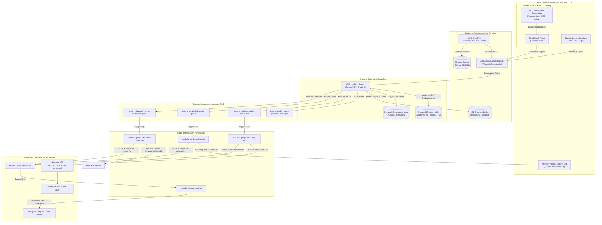
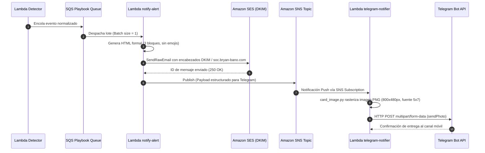

# 02. Arquitectura Técnica y Flujos de Datos

## 1. Diagrama de Arquitectura Global

La infraestructura del laboratorio implementa un modelo **Serverless Event-Driven** (orientado a eventos) con alta disponibilidad y desacoplamiento mediante colas de mensajería (Amazon SQS) y tópicos de publicación/suscripción (Amazon SNS).

---

## 2. Flujo Detallado de Telemetría e Ingesta

### 2.1. Aplicación Web y CloudWatch Agent
1. La aplicación corporativa simula un portal de autenticación empresarial desarrollado en Python (`app.py`), ejecutándose bajo el usuario del sistema `tesisportal` y detrás de un reverse proxy **Nginx**.
2. Por principio de mínimo privilegio, la instancia EC2 **no tiene permisos para invocar directamente CloudWatch, DynamoDB ni S3**.
3. La aplicación escribe eventos JSON puros en un archivo local: `/var/log/tesis-portal/app.log`.
4. El demonio oficial **Amazon CloudWatch Agent** lee continuamente el archivo local y lo transfiere de manera cifrada (TLS) al grupo de logs `/aws/ec2/tesis-ir-portal-app`.

### 2.2. Tráfico de Red (VPC Flow Logs)
1. Sobre la Elastic Network Interface (ENI) de la EC2 se habilitan VPC Flow Logs en formato estándar v2.
2. Cada paquete rechazado (`REJECT`) por los Security Groups se captura y se entrega directamente a CloudWatch Logs en `/aws/vpc/tesis-ir-flowlogs`.

### 2.3. Auditoría de Actividades (AWS CloudTrail)
1. CloudTrail captura todos los `Management Events` (eventos de administración como `CreateUser`, `AttachUserPolicy`, `GetCallerIdentity`, etc.) y los entrega en tiempo real al grupo `/aws/cloudtrail/tesis-ir-management`.
2. Opcionalmente (mediante la variable `enable_s3_data_events`), CloudTrail monitoriza llamadas a nivel de objeto S3 (`GetObject`, `PutObject`) sobre el bucket clasificado como confidencial.

---

## 3. Patrón de Desacoplamiento Fan-Out con SQS

Para evitar condiciones de carrera y la competencia de consumidores en colas únicas, el sistema implementa un **patrón de abanico (Fan-Out) gobernado por el Lambda Detector**:

1. **Cola de Contrato (`tesis-ir-incident-queue`):** Almacena todo incidente para cumplimiento con el Componente B y para posibilitar la conexión de consumidores externos futuros.
2. **Cola de Notificaciones (`tesis-ir-playbook-notify-alert-queue`):** Recibe **todos** los incidentes confirmados. Su consumidor (`playbook-notify-alert`) genera la notificación primaria para el equipo SOC.
3. **Cola de Mitigación de Red (`tesis-ir-playbook-block-ip-queue`):** Solo recibe incidentes clasificados como de amenaza perimetral (`BRUTE_FORCE`, `PORT_SCAN`). Su consumidor (`playbook-block-ip`) interactúa con la Network ACL.
4. **Cola de Mitigación de Identidad (`tesis-ir-playbook-revoke-credentials-queue`):** Solo recibe incidentes de compromiso de credenciales (`PRIVILEGE_ESCALATION`, `CREDENTIAL_LEAK`). Su consumidor (`playbook-revoke-credentials`) interactúa con AWS IAM.

---

## 4. Pipeline de Notificación y Generación Gráfica

### Características de las Notificaciones:
- **Estructura Estricta de 3 Bloques:**
  1. `INFORMACION GENERAL`: Tipo de incidente, ID único, estado y playbook activo.
  2. `RECURSO Y ORIGEN / CONTENCION`: IP atacante, recurso AWS afectado, servicio y activo.
  3. `CRITERIO Y TRAZABILIDAD`: Umbrales de detección superados, timestamp local de Ecuador (`America/Guayaquil`) y URI del objeto en S3.
- **Identidad Gráfica:**
  - Código cromático según severidad: Rojo (`CRITICAL`), Naranja (`HIGH`), Ámbar (`MEDIUM`), Azul (`LOW` / `CONTAINED`).
  - Cero dependencias binarias externas: el renderizado visual de la imagen PNG se realiza mediante álgebra de bytes pura (`zlib` + `struct`).
