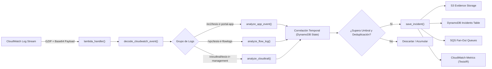

# 04. Motor de Detección Serverless y Matriz de IoCs

## 1. Funcionamiento del Lambda Detector

El motor de detección está implementado en la función [`lambda/lambda_function.py`](file:///home/bryan/Projects/LOCALSTACK/localstack-tesis/terraform-tesis-ir-secure-portal/lambda/lambda_function.py) y se activa de manera reactiva mediante **CloudWatch Logs Subscription Filters**:



---

## 2. Matriz de Cobertura de Incidentes

El sistema cubre de forma integral los 5 escenarios planteados en la tesis de grado:

| Incidente | Tipo Técnico | Fuente de Telemetría | Severidad | Ventana | Umbral de Activación | Mitigación Ejecutada | Playbooks |
|---|---|---|---|---|---|---|---|
| **1** | `BRUTE_FORCE` | Logs de Aplicación EC2 / `ConsoleLogin` | `HIGH` (Naranja) | 5 minutos | 5 o más fallos de autenticación desde una misma IP | Inserción de regla `DENY` en Network ACL | `notify-alert`, `block-ip` |
| **2** | `PORT_SCAN` | VPC Flow Logs (`REJECT`) | `MEDIUM` (Ámbar) | 5 minutos | Conexiones rechazadas hacia 10 o más puertos distintos | Inserción de regla `DENY` en Network ACL | `notify-alert`, `block-ip` |
| **3** | `PRIVILEGE_ESCALATION` | AWS CloudTrail (`AttachUserPolicy`) | `CRITICAL` (Rojo) | Inmediata | Adjunción no autorizada de políticas administrativas a usuarios/roles | Revocación de Access Keys + `EmergencyDenyAll` | `notify-alert`, `revoke-credentials` |
| **4** | `CREDENTIAL_LEAK` | AWS CloudTrail (`GetCallerIdentity`) | `CRITICAL` (Rojo) | Inmediata | Uso de credenciales válidas desde una IP fuera del rango autorizado | Revocación de Access Keys + `EmergencyDenyAll` | `notify-alert`, `revoke-credentials` |
| **5** | `EXFILTRATION` | CloudTrail S3 Data Events (`GetObject`) | `HIGH` (Naranja) | 60 minutos | Descarga anómala de más de 50 objetos del bucket confidencial | Registro forense y notificación ejecutiva | `notify-alert` |

---

## 3. Algoritmos de Detección Detallados

### 3.1. Incidente 1: Ataque de Fuerza Bruta (`BRUTE_FORCE`)
- **Extracción:** La función `analyze_app_event()` evalúa eventos JSON generados por el portal web:
  ```json
  {"event": "login_failed", "username": "admin.demo", "client_ip": "185.220.101.5", "reason": "invalid_password"}
  ```
- **Contador en DynamoDB:**
  - Clave primaria (`pk`): `bruteforce#<client_ip>#user#<username>#window#<ventana_5min>`
  - Clave de ordenamiento (`sk`): `counter`
  - Operación: `ADD count 1` atómica con TTL de 15 minutos.
- **Criterio de Disparo:** Cuando `count >= 5`, se verifica `mark_alert_once()` para asegurar que no se re-despachen alertas duplicadas durante la misma ventana de ataque.

### 3.2. Incidente 2: Escaneo de Puertos (`PORT_SCAN`)
- **Extracción:** La función `analyze_flow_log()` procesa líneas de VPC Flow Logs (versión 2):
  ```text
  2 123456789012 eni-0123 192.168.1.50 10.10.1.15 45210 8080 6 1 40 1620000000 1620000060 REJECT OK
  ```
- **Criterio de Filtrado:** Solo se evalúan registros con acción `REJECT` provenientes de IPs no autorizadas.
- **Conteo de Puertos Únicos en DynamoDB:**
  - Clave primaria (`pk`): `portscan#<srcaddr>#window#<ventana_5min>`
  - Clave de ordenamiento (`sk`): `port#<dstport>`
  - Conteo: Se ejecuta una consulta `Query` con `Select="COUNT"` sobre la partición `pk`.
- **Criterio de Disparo:** Cuando la cuenta de puertos distintos es `>= 10`.

### 3.3. Incidente 3: Escalada de Privilegios (`PRIVILEGE_ESCALATION`)
- **Extracción:** La función `analyze_cloudtrail()` inspecciona eventos de API de AWS:
  - Eventos monitorizados: `AttachUserPolicy`, `AttachRolePolicy`, `PutUserPolicy`, `CreatePolicyVersion`, `PutRolePolicy`.
- **Criterio de Disparo:** Si un usuario sin rol de administrador asigna políticas que contienen privilegios elevados (tales como `AdministratorAccess`, `*` o permisos sensibles de modificación IAM), el incidente se clasifica de inmediato como `CRITICAL`.
- **Acción:** No requiere ventana deslizante; se dispara al primer indicio confirmado.

### 3.4. Incidente 4: Fuga de Credenciales (`CREDENTIAL_LEAK`)
- **Extracción:** Se monitorizan llamadas a la API de AWS (`GetCallerIdentity`, `DescribeInstances`, etc.) registradas en CloudTrail.
- **Validación de Red:** La función `ip_in_cidrs(sourceIPAddress, authorized_cidrs)` evalúa si la llamada proviene de una IP fuera de la lista blanca institucional (`ssh_allowed_cidr` / `authorized_ip_cidrs`).
- **Criterio de Disparo:** Si una identidad válida ejecuta llamadas autenticadas desde una IP desconocida o de origen potencialmente malicioso en Internet. Severidad clasificada como `CRITICAL`.

### 3.5. Incidente 5: Exfiltración de Datos S3 (`EXFILTRATION`)
- **Extracción:** Se analizan eventos de CloudTrail S3 Data Events donde `eventName == "GetObject"` y el recurso coincide con el bucket sensible configurado (`sensitive_bucket`).
- **Contador en DynamoDB:**
  - Clave primaria (`pk`): `exfiltration#<client_ip>#bucket#<bucket_name>#window#<ventana_60min>`
  - Umbral: Se activa al registrar más de 50 descargas en una hora. Severidad clasificada como `HIGH`.

---

## 4. Contrato de Datos Normalizado y Fan-Out

Cuando un incidente supera los umbrales de detección, la función `save_incident()` realiza las siguientes operaciones en paralelo:

1. **Generación de Identificador Único:** `INC-<YYYYMMDDHHMMSS>-<UUID8>`.
2. **Persistencia Forense en S3:** Guarda el documento completo con el evento crudo (`raw_event`), resumen analítico, marca de tiempo UTC y marca de tiempo local de Ecuador (`America/Guayaquil`) en:
   `s3://<evidence_bucket>/<incident_folder>/<incident_id>.json`.
3. **Registro en DynamoDB:** Inserta un registro en `tesis-ir_incidents` con estado inicial `DETECTED`.
4. **Despacho Multicola (Fan-Out SQS):**
   - Publica el payload JSON normalizado a `tesis-ir-incident-queue`.
   - Publica a `tesis-ir-playbook-notify-alert-queue`.
   - Si el incidente es de red (`BRUTE_FORCE`, `PORT_SCAN`), publica a `tesis-ir-playbook-block-ip-queue`.
   - Si el incidente es de credenciales (`PRIVILEGE_ESCALATION`, `CREDENTIAL_LEAK`), publica a `tesis-ir-playbook-revoke-credentials-queue`.
5. **Métricas en CloudWatch:** Emite un punto métrico con Namespace `TesisIR`, nombre `IncidentDetected` y dimensiones por tipo de incidente y severidad.
