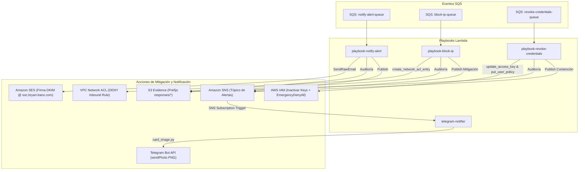

# 05. Playbooks de Respuesta y Contención Automatizada

## 1. Visión General de los Playbooks (Componente C)

Los playbooks representan la capacidad de **Respuesta Activa (Active Response)** del sistema. Cada playbook es una función serverless en AWS Lambda diseñada para ejecutarse de forma idempotente, registrar trazabilidad forense y notificar al equipo de seguridad.



---

## 2. Playbook 1: `notify-alert` (Notificación y Reporte SOC)

- **Ubicación:** [`terraform-tesis-ir-secure-portal/playbooks/notify_alert/handler.py`](file:///home/bryan/Projects/LOCALSTACK/localstack-tesis/terraform-tesis-ir-secure-portal/playbooks/notify_alert/handler.py)
- **Activación:** Event Source Mapping desde la cola SQS `tesis-ir-playbook-notify-alert-queue`.
- **Propósito:** Genera el informe institucional de seguridad y lo remite a Gmail con validación criptográfica y al tópico SNS.

### Formato de Tarjeta HTML Profesional
El cuerpo del correo está diseñado bajo estándares corporativos y contiene 3 bloques temáticos:
1. **INFORMACION GENERAL:** Tipo de incidente, ID único autogenerado, severidad cromática y playbook invocado.
2. **RECURSO Y ORIGEN / CONTENCION:** Dirección IP atacante, recurso AWS bajo agresión, servicio y activo tecnológico.
3. **CRITERIO Y TRAZABILIDAD:** Regla o umbral superado, fecha/hora en zona de Ecuador (`America/Guayaquil`) y ruta S3 del log forense.

### Entrega Criptográfica vía Amazon SES
- El correo se envía utilizando la API `SendEmail` o `SendRawEmail` de SES desde `alertas@soc.bryan-bano.com`.
- El servidor receptor (Google Gmail) valida los registros CNAME DKIM (`100% DKIM PASS`), SPF (`amazonses.com PASS`) y DMARC (`PASS`), evitando la carpeta de Spam.

---

## 3. Playbook 2: `block-ip` (Mitigación Perimetral en Red)

- **Ubicación:** [`terraform-tesis-ir-secure-portal/playbooks/block_ip/handler.py`](file:///home/bryan/Projects/LOCALSTACK/localstack-tesis/terraform-tesis-ir-secure-portal/playbooks/block_ip/handler.py)
- **Incidentes que lo activan:** `BRUTE_FORCE` y `PORT_SCAN`.
- **Mecanismo de Mitigación Real:**
  1. Identifica la Network ACL (NACL) asociada a la subred pública donde reside el portal.
  2. Consulta las reglas existentes e identifica el primer número de regla libre dentro del rango prioritario (`RULE_MIN=1` a `RULE_MAX=99`).
  3. Ejecuta la llamada API de EC2:
     ```python
     ec2.create_network_acl_entry(
         NetworkAclId=target_nacl_id,
         RuleNumber=free_rule_number,
         Protocol="-1",             # Todo tráfico (TCP, UDP, ICMP)
         RuleAction="deny",          # Bloqueo explícito
         Egress=False,               # Regla Inbound
         CidrBlock=f"{source_ip}/32"
     )
     ```
  4. Registra el estado en S3 Evidence bajo `responses/block-ip/<incident_id>.json`.
  5. Emite una notificación de mitigación con estado `BLOCKED` (cabecera roja) hacia Amazon SNS para alertar al analista en Telegram.

### Recuperación de Acceso / Rollback
Si la IP pública del operador es bloqueada durante una prueba, el acceso se restaura eliminando la regla en la Network ACL:
```bash
aws ec2 delete-network-acl-entry --network-acl-id <NACL_ID> --rule-number <RULE_NUMBER> --ingress
```

---

## 4. Playbook 3: `revoke-credentials` (Contención de Identidad IAM)

- **Ubicación:** [`terraform-tesis-ir-secure-portal/playbooks/revoke_credentials/handler.py`](file:///home/bryan/Projects/LOCALSTACK/localstack-tesis/terraform-tesis-ir-secure-portal/playbooks/revoke_credentials/handler.py)
- **Incidentes que lo activan:** `PRIVILEGE_ESCALATION` y `CREDENTIAL_LEAK`.
- **Mecanismo de Contención Real:**
  1. Extrae el nombre de la identidad comprometida a partir del formato `iam:user/<username>`.
  2. Consulta las claves de acceso de la identidad y las desactiva inmediatamente:
     ```python
     for key in iam.list_access_keys(UserName=username)["AccessKeyMetadata"]:
         if key["Status"] == "Active":
             iam.update_access_key(
                 UserName=username,
                 AccessKeyId=key["AccessKeyId"],
                 Status="Inactive"
             )
     ```
  3. Adjunta una política de contingencia inmediata de denegación total (`EmergencyDenyAll`):
     ```python
     deny_all_policy = {
         "Version": "2012-10-17",
         "Statement": [{
             "Effect": "Deny",
             "Action": "*",
             "Resource": "*"
         }]
     }
     iam.put_user_policy(
         UserName=username,
         PolicyName="EmergencyDenyAll",
         PolicyDocument=json.dumps(deny_all_policy)
     )
     ```
  4. Registra la evidencia forense en S3 bajo `responses/revoke-credentials/<incident_id>.json`.
  5. Emite un evento de contención con estado `CONTAINED` (cabecera azul marino) hacia SNS.

### Restauración de Identidad / Rollback
Para restablecer al usuario tras la investigación:
```bash
aws iam delete-user-policy --user-name <USUARIO> --policy-name EmergencyDenyAll
# Si se desea reactivar la clave:
aws iam update-access-key --user-name <USUARIO> --access-key-id <KEY_ID> --status Active
```

---

## 5. Playbook 4: `telegram-notifier` y Motor Gráfico Nativo (`card_image.py`)

- **Ubicación:** [`terraform-tesis-ir-secure-portal/playbooks/telegram_notifier/`](file:///home/bryan/Projects/LOCALSTACK/localstack-tesis/terraform-tesis-ir-secure-portal/playbooks/telegram_notifier/)
- **Archivos:** `handler.py` y `card_image.py`.
- **Innovación Técnica Destacada:** Generación de tarjetas de seguridad en formato de imagen PNG **utilizando exclusivamente Python estándar (`zlib`, `struct`, `io`) sin librerías externas (como Pillow o OpenCV) y sin capas Lambda adicionales.**

### Arquitectura del Renderizador Rasterizador (`card_image.py`):
1. **Mapa de Bits Embebido:** Incluye un arreglo de fuentes de mapa de bits de 5x7 píxeles para todos los caracteres imprimibles ASCII (códigos 32 a 126).
2. **Buffer Gráfico en Memoria:** Modela una cuadrícula bidimensional de píxeles RGBA (ancho estándar: 800px; alto dinámico: ~480px a 560px).
3. **Primitivas de Dibujo:**
   - `draw_rect`: Dibuja rectángulos rellenos para cabeceras y cajas de diagnóstico.
   - `draw_text`: Rasteriza cadenas de caracteres escaladas (x1, x2) con espaciado uniforme.
   - `draw_badge`: Dibuja insignias ovaladas con fondo coloreado y texto de estado (`DETECTED`, `BLOCKED`, `CONTAINED`).
   - `draw_table`: Dibuja tablas de claves y valores alineadas milimétricamente con separadores visuales.
4. **Codificador PNG Puro:**
   - Construye la cabecera estándar PNG (`\x89PNG\r\n\x1a\n`).
   - Inserta el chunk `IHDR` con dimensiones, profundidad de color (8 bits) y tipo de color (RGBA).
   - Comprime los renglones con filtro tipo 0 usando `zlib.compress(level=6)` para generar el chunk `IDAT`.
   - Cierra con el chunk `IEND`.

### Despacho vía Telegram API (`handler.py`):
- Escucha notificaciones SNS.
- Llama a `create_incident_card_image(data)` obteniendo los bytes PNG.
- Construye un payload `multipart/form-data` con delimitador aleatorio (boundary).
- Realiza una petición `HTTP POST` con `urllib.request.urlopen` hacia:
  `https://api.telegram.org/bot<TELEGRAM_BOT_TOKEN>/sendPhoto`.
- Entrega una experiencia visual limpia e inmediata en teléfonos móviles y clientes de escritorio de Telegram, eliminando la necesidad de leer textos largos en pantallas pequeñas.
