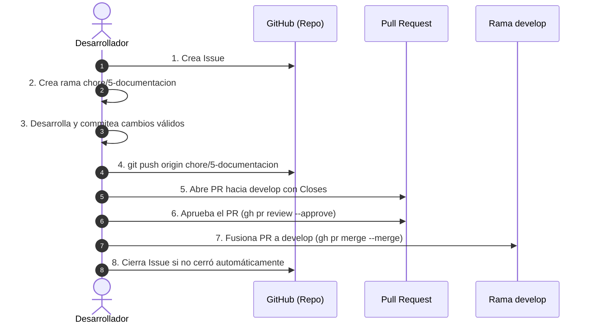

# 07. Convención de Ramas, Commits y GitFlow

Esta guía formaliza las políticas obligatorias de control de versiones y flujo de trabajo colaborativo para el desarrollo del proyecto de grado en GitHub, adaptadas a los estándares del **ISTPET**.

---

## 1. Reglas Fundamentales de GitFlow

1. **Ramas Permanentes Protegidas:**
   - **`main`:** Representa el estado estable y verificado de producción / versión defendida de la tesis.
   - **`develop`:** Representa la rama activa de integración continua. Toda nueva funcionalidad o documentación se integra primero aquí.
   - **PROHIBIDO:** Hacer `git push` directo sobre `main` o sobre `develop`. Todo cambio ingresa estrictamente mediante **Pull Requests (PR)**.
2. **Desarrollo Basado en Issues:**
   - Antes de escribir código o documentación, se debe contar con un **Issue** creado en GitHub que describa el alcance y los criterios de aceptación.
3. **Flujo de Integración a Producción:**
   - De `develop` a `main` se pasa únicamente tras haber probado y validado los playbooks y pruebas en `develop`.

---

## 2. Nomenclatura Obligatoria de Ramas

Toda rama de trabajo se crea **siempre a partir de `develop` actualizado**:

```bash
git checkout develop
git pull origin develop
git checkout -b <tipo>/<id>-<slug>
```

### Formato:
`<tipo>/<id>-<slug>`

- `<tipo>`: Tipo de cambio permitido según la tabla inferior.
- `<id>`: Número numérico del Issue asociado (sin `#`).
- `<slug>`: Descripción breve en minúsculas separada por guiones.

### Tipos de Ramas Permitidas:
| Prefijo | Origen | Destino PR | Propósito | Ejemplo |
|---|---|---|---|---|
| `feature/<id>-slug` | `develop` | `develop` | Nuevas capacidades o playbooks | `feature/8-playbook-isolate-ec2` |
| `bugfix/<id>-slug` | `develop` | `develop` | Corrección de fallos en playbooks existentes | `bugfix/9-fix-nacl-rule-ordering` |
| `chore/<id>-slug` | `develop` | `develop` | Documentación, CI/CD, limpieza o dependencias | `chore/5-documentacion-arquitectura` |
| `release/<x>.<y>` | `develop` | `main` | Preparación de corte de entrega final de tesis | `release/1.0` |
| `hotfix/<id>-slug` | `main` | `main` y `develop` | Corrección urgente sobre producción | `hotfix/10-fix-ses-dkim-fallback` |

---

## 3. Convención de Mensajes de Commit

Los mensajes de commit deben ser claros, profesionales y descriptivos:

1. **Longitud del Asunto (primera línea):** Entre **10 y 72 caracteres**.
2. **Estructura Recomendada (Conventional Commits):**
   `<tipo>: <descripción concisa>`
   - `feat:` Nuevas funcionalidades (ej: nuevo playbook, nuevo detector).
   - `fix:` Correcciones de errores técnicos.
   - `docs:` Cambios o adiciones en documentación técnica.
   - `refactor:` Mejoras en la estructura del código sin cambiar comportamiento.
   - `chore:` Tareas de mantenimiento, actualización de Terraform o dependencias.
3. **Mensajes Prohibidos (Rechazados):**
   - Palabras vagas como `wip`, `update`, `fix`, `test`, `cambios`, `arreglos`, `minor` o puntos sueltos (`.`).
4. **Ejemplos Válidos:**
   - `docs: agregar especificacion tecnica del playbook block-ip`
   - `feat: implementar deserializador de eventos CloudTrail en detector`
   - `fix: corregir asignacion de puertos unicos en tabla de estado`

---

## 4. Ciclo de Vida de un Pull Request (PR)



### Protocolo de Cierre Directo (Sin Ruido Adicional):
- Todo el contexto, criterios de aceptación y referencias a issues (`Closes #<id>`) deben incluirse directamente en el cuerpo (`body`) inicial del PR al crearse con `gh pr create`.
- No se deben emitir comentarios adicionales repetitivos en el hilo del PR ni en el Issue.
- Una vez fusionado a `develop`, si el Issue no se cierra automáticamente, se cierra directamente con `gh issue close <id> --reason completed`.
