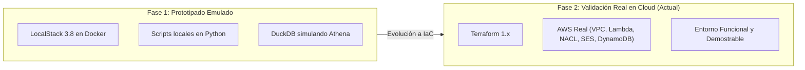

# 08. Estrategia de Costos, Entornos y Presupuesto

## 1. Modelo de Costos en AWS (Arquitectura de Bajo Costo)

Uno de los principios de diseño fundamentales de este trabajo de titulación es la **viabilidad económica**. Los entornos de laboratorio tradicionales en AWS frecuentemente generan costos imprevistos debido a servicios con tarifa base fija por hora.

Para mitigar este riesgo, la arquitectura implementada en Terraform aplica un diseño **100% Serverless y de consumo por demanda**:

### 1.1. Recursos Costosos Excluidos Deliberadamente:
Para evitar sobrecostos, el código Terraform **NO crea** ninguno de los siguientes servicios:
- **NAT Gateway:** Se evita su uso situando la EC2 del portal directamente en subred pública con Security Group restrictivo (Ahorro: ~$32.40 USD/mes).
- **Application Load Balancer (ALB):** Nginx actúa como reverse proxy local en la propia EC2 (Ahorro: ~$22.50 USD/mes).
- **Amazon RDS / Aurora:** Se utiliza DynamoDB On-Demand y tablas con TTL (Ahorro: ~$18.00 USD/mes).
- **Amazon OpenSearch Service:** Las consultas forenses analíticas se delegan a Amazon Athena (pago por TB escaneado) (Ahorro: ~$45.00 USD/mes).
- **AWS Network Firewall:** La contención perimetral se ejecuta directamente en las Network ACLs (NACL) nativas de la VPC, las cuales no tienen costo por regla ni por hora (Ahorro: ~$280.00 USD/mes).

### 1.2. Cobertura de la Capa Gratuita (AWS Free Tier):
| Servicio | Consumo en el Laboratorio | Cobertura Free Tier |
|---|---|---|
| **EC2** (`t3.micro` / `t2.micro`) | 1 instancia activa solo durante pruebas | 750 horas/mes gratuitas |
| **AWS Lambda** | 5 funciones con bajo volumen de invocaciones | 1,000,000 solicitudes/mes gratis |
| **Amazon DynamoDB** | Modo On-Demand, tablas con TTL | 25 GB de almacenamiento gratis |
| **Amazon SQS** | 4 colas estándar con polling esporádico | 1,000,000 solicitudes/mes gratis |
| **Amazon SNS** | 1 tópico de alertas | 1,000,000 publicaciones/mes gratis |
| **Amazon SES** | Envío de reportes SOC hacia Gmail | 62,000 correos/mes si se llama desde EC2 |
| **Amazon CloudWatch** | Grupos de logs con retención ajustada | 5 GB de ingesta de logs gratis |

---

## 2. Variables de Control de Costos en Terraform

El archivo `variables.tf` expone controles específicos para mantener los costos bajo control estricto:

```hcl
# Mantener en false excepto durante la prueba específica de exfiltración
enable_s3_data_events = false

# Mantener en false para no incurrir en cargos de grabación de recursos
enable_aws_config     = false

# Una sola región (ca-central-1) para evitar duplicidad de logs
cloudtrail_multi_region = false

# Límite máximo mensual de gasto
monthly_budget_limit_usd = 5
create_budget            = true
```

### Presupuesto Automatizado (AWS Budgets):
Si se especifica `alert_email`, Terraform crea un recurso `aws_budgets_budget` de $5.00 USD mensuales. AWS enviará una alerta automática si:
1. El gasto real supera el 80% ($4.00 USD).
2. El gasto pronosticado supera el 100% ($5.00 USD).

---

## 3. Estrategia de Entornos: LocalStack vs AWS Real

El proyecto transitó por dos fases evolutivas durante la investigación:



### Relación entre Ambientes:
1. **Fase Inicial (LocalStack):** Se utilizó para validar la sintaxis de las llamadas a boto3 y verificar la lógica de los playbooks en contenedores Docker locales sin necesidad de credenciales reales.
2. **Fase de Consolidación (AWS Real con Terraform):** El proyecto evolucionó hacia un despliegue de Infraestructura como Código directamente en AWS, permitiendo validar componentes que requieren infraestructura real de red (Network ACLs de VPC, firmas DKIM verificadas en DNS público y webhooks de Telegram en tiempo real).
3. **Buenas Prácticas de Operación:**
   - Para demostraciones o trabajo diario en la tesis, se ejecuta `terraform apply`.
   - Al terminar la jornada, se ejecuta `terraform destroy -auto-approve` para garantizar costo cero en los periodos de inactividad.
