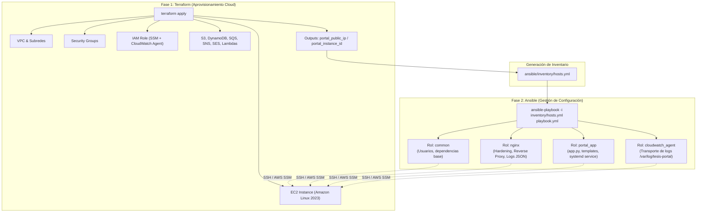

# 09. Integración de Ansible para Gestión de Configuración (CM)

## 1. Justificación Técnica y Académica para la Tesis

En la arquitectura inicial del proyecto, el aprovisionamiento de la instancia EC2 y todo el software del portal web corporativo se concentraba en un script Bash monolítico dentro de [`terraform-tesis-ir-secure-portal/scripts/user_data.sh.tpl`](file:///home/bryan/Projects/LOCALSTACK/localstack-tesis/terraform-tesis-ir-secure-portal/scripts/user_data.sh.tpl) de más de 500 líneas.

Aunque `user_data` es funcional para demostraciones rápidas, en la práctica de ingeniería y en una tesis de grado sobre seguridad y automatización presenta limitaciones severas:
1. **Falta de Idempotencia en Caliente:** `user_data` se ejecuta únicamente en el primer inicio de la máquina (`cloud-init`). Cualquier ajuste posterior en la aplicación web, en las reglas de Nginx o en la configuración de CloudWatch Agent obliga a forzar la destrucción y reemplazo de la instancia (`terraform apply -replace="aws_instance.portal"`), interrumpiendo el servicio y regenerando la IP pública.
2. **Dificultad de Depuración y Auditoría:** Los errores en Bash no ofrecen rollback estructurado ni trazabilidad por tarea.
3. **Violación del Principio de Separación de Responsabilidades:** Mezcla la creación de recursos de infraestructura con la configuración del sistema operativo.

### Paradigma: IaC vs Configuration Management

| Dimensión | Terraform (Orquestación IaC) | Ansible (Gestión de Configuración CM) |
|---|---|---|
| **Propósito** | Crear y destruir recursos de infraestructura en la nube (VPC, Subredes, EC2, S3, SQS, Lambdas). | Configurar el sistema operativo, instalar paquetes, desplegar código y gestionar servicios. |
| **Enfoque** | Declarativo de estado de infraestructura. | Procedimental declarativo e idempotente a nivel de SO. |
| **Agente** | Sin agente (API de AWS). | Sin agente (Agentless mediante SSH o AWS Systems Manager). |
| **Ciclo de Vida** | Se ejecuta cuando la topología de red o los recursos cloud cambian. | Se ejecuta continuamente o ante actualizaciones de software y parches. |

---

## 2. Arquitectura de Despliegue en Dos Fases



---

## 3. Estructura Modular de Ansible

El directorio `ansible/` se ubica en la raíz del repositorio, separado del directorio de Terraform:

```text
localstack-tesis/
├── terraform-tesis-ir-secure-portal/      ← Infraestructura en AWS
│   ├── main.tf
│   ├── variables.tf
│   └── outputs.tf
│
├── ansible/                               ← Gestión de Configuración (Nuevo)
│   ├── ansible.cfg                        ← Parámetros globales (SSH timeout, forks, etc.)
│   ├── playbook.yml                       ← Orquestador de ejecución de roles
│   ├── inventory/
│   │   ├── hosts.yml                      ← Inventario con la IP pública de la EC2
│   │   └── group_vars/
│   │       └── all.yml                    ← Variables compartidas (rutas, puertos, usuarios)
│   │
│   └── roles/
│       ├── common/                        ← Configuración base del sistema
│       │   ├── tasks/main.yml             ← dnf update, paquetes base (python3, curl, git)
│       │   └── vars/main.yml              ← Usuario del sistema (tesisportal)
│       │
│       ├── nginx/                         ← Servidor Web y Reverse Proxy
│       │   ├── tasks/main.yml             ← Instalación y habilitación del servicio
│       │   ├── templates/
│       │   │   ├── nginx.conf.j2          ← Configuración global con formato de log JSON
│       │   │   └── tesis-portal.conf.j2   ← Virtual host proxy inverso hacia 127.0.0.1:8080
│       │   └── handlers/main.yml          ← Handler para reload/restart de Nginx
│       │
│       ├── portal_app/                    ← Aplicación de Autenticación de Laboratorio
│       │   ├── tasks/main.yml             ← Despliegue de app.py, permisos 750/640
│       │   ├── files/
│       │   │   └── app.py                 ← Código fuente limpio de la app Python
│       │   ├── templates/
│       │   │   └── tesis-portal.service.j2← Archivo de servicio systemd con restart on-failure
│       │   └── handlers/main.yml          ← Handler para daemon-reload y restart del servicio
│       │
│       └── cloudwatch_agent/              ← Agente de Telemetría Oficial
│           ├── tasks/main.yml             ← Instalación de amazon-cloudwatch-agent
│           ├── templates/
│           │   └── config.json.j2         ← Mapeo de /var/log/tesis-portal/app.log a CW Logs
│           └── handlers/main.yml          ← Handler para aplicar configuración con ctl
```

---

## 4. Detalle de los Roles de Ansible

### 4.1. Rol `common`
- **Objetivo:** Preparar el sistema operativo Amazon Linux 2023.
- **Acciones:**
  - Actualizar paquetes del sistema: `dnf update -y`.
  - Crear el grupo y usuario del sistema `tesisportal` sin shell interactivo (`/sbin/nologin`).
  - Crear directorios de ejecución `/opt/tesis-portal` y de bitácora `/var/log/tesis-portal` con permisos estrictos (`chmod 750`).

### 4.2. Rol `nginx`
- **Objetivo:** Actuar como escudo perimetral local y reverse proxy seguro.
- **Acciones:**
  - Instalar Nginx desde repositorios oficiales.
  - Configurar encabezados de seguridad HTTP:
    - `X-Frame-Options: SAMEORIGIN`
    - `X-Content-Type-Options: nosniff`
    - `X-XSS-Protection: 1; mode=block`
  - Reenviar el tráfico entrante del puerto 80 hacia `http://127.0.0.1:8080` preservando la IP real del cliente mediante la cabecera `X-Forwarded-For`.
  - Configurar logs de acceso en formato JSON estructurado para facilitar la ingesta analítica.

### 4.3. Rol `portal_app`
- **Objetivo:** Desplegar el portal web corporativo que sirve como vector de prueba de incidentes.
- **Acciones:**
  - Copiar el código fuente modular de `app.py`.
  - Crear el archivo de secreto de sesión con entropía criptográfica (`secrets.token_hex(32)`).
  - Instalar la unidad systemd `/etc/systemd/system/tesis-portal.service`.
  - Asegurar que el servicio inicie automáticamente con el sistema y se reinicie ante fallos.

### 4.4. Rol `cloudwatch_agent`
- **Objetivo:** Enviar telemetría en tiempo real hacia Amazon CloudWatch Logs.
- **Acciones:**
  - Instalar el paquete `amazon-cloudwatch-agent`.
  - Desplegar la plantilla `config.json` apuntando a:
    - Log file: `/var/log/tesis-portal/app.log`
    - Log Group en AWS: `/aws/ec2/tesis-ir-portal-app`
    - Log Stream Name: `{instance_id}`
  - Iniciar el agente mediante el comando nativo:
    ```bash
    /opt/aws/amazon-cloudwatch-agent/bin/amazon-cloudwatch-agent-ctl \
      -a fetch-config -m ec2 -s -c file:/opt/aws/amazon-cloudwatch-agent/etc/amazon-cloudwatch-agent.json
    ```

---

## 5. Estrategia de Conectividad (Agentless)

Para que Ansible se comunique con la instancia EC2 existen dos métodos:

### Método A: SSH Clásico con Llave Privada (Recomendado para pruebas rápidas)
1. Terraform genera o asocia una llave pública `aws_key_pair`.
2. El Security Group permite tráfico SSH (puerto 22) restringido exclusivamente a tu IP pública (`ssh_allowed_cidr`).
3. Ansible se conecta vía SSH:
   ```bash
   ansible-playbook -i inventory/hosts.yml playbook.yml --private-key ~/.ssh/id_rsa -u ec2-user
   ```

### Método B: AWS Systems Manager (SSM) Session Manager (Máxima Seguridad para la Tesis)
1. **Cero Puertos Abiertos:** El puerto 22 SSH permanece cerrado en el Security Group (`0` exposición en internet).
2. La instancia ya tiene el rol IAM con la política administrada `AmazonSSMManagedInstanceCore`.
3. Ansible utiliza el plugin de conexión `community.aws.aws_ssm`, conectándose de forma segura a través del túnel cifrado de la API de AWS.

---

## 6. Plan de Transición de `user_data` hacia Ansible

1. **Paso 1: Reducir `user_data.sh.tpl`**  
   El script de Terraform solo instalará `python3` y asegurará que el agente SSM o la llave SSH estén disponibles.
2. **Paso 2: Generar Inventario Dinámico o Estático**  
   Al culminar `terraform apply`, se toma el output `portal_public_ip` para poblar `ansible/inventory/hosts.yml`.
3. **Paso 3: Ejecución de Ansible**  
   Se ejecuta `ansible-playbook` aplicando los 4 roles.
4. **Paso 4: Validación de Incidentes**  
   Se prueba el ataque de fuerza bruta con `curl` verificando que CloudWatch Agent transporte los logs y el motor Lambda active la mitigación en la Network ACL.
