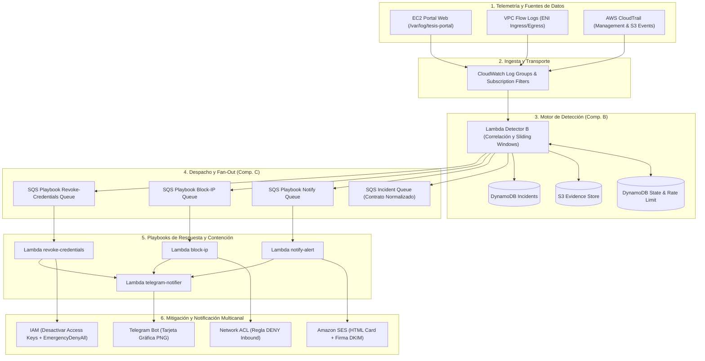

# Documentación Técnica del Sistema de Detección y Respuesta Automatizada ante Incidentes en AWS

La gestion de configuracion ya esta implementada: [Ansible y despliegue del portal](../ansible/README.md), [Forgejo Actions y proteccion de develop](11-forgejo-actions-y-proteccion-develop.md).

**Trabajo de Integración Curricular (Tesis de Grado)**  
**Tema:** Diseño e Implementación de un Sistema de Detección y Respuesta ante Incidentes de Seguridad en Entornos Cloud (AWS)  
**Autor Principal (Componente C - Automatización de Respuesta):** Bryan Baño  
**Entorno Principal:** Amazon Web Services (AWS) desplegado con Terraform  
**Dominio de Notificaciones SOC:** `soc.bryan-bano.com` (Firmado con DKIM / SPF / DMARC en Amazon SES)

---

## 1. Visión General

Esta carpeta contiene la documentación técnica exhaustiva del proyecto de grado, el cual materializa un sistema de **Seguridad de Operaciones Cloud (Cloud SOC)** automatizado, de bajo costo y alta fidelidad forense sobre Amazon Web Services.

El sistema monitoriza telemetría en tiempo real (logs de aplicaciones web en EC2, VPC Flow Logs a nivel ENI y eventos de gestión y datos en AWS CloudTrail), detecta patrones de ataque e Indicadores de Compromiso (IoCs) mediante funciones serverless de correlación temporal, y ejecuta contención activa en segundos (bloqueo de tráfico perimetral en Network ACLs y aislamiento/revocación de identidades IAM con políticas de contingencia `EmergencyDenyAll`), despachando alertas corporativas formateadas en HTML y tarjetas visuales en formato PNG generadas de forma nativa en Lambda hacia Gmail y Telegram.

---

## 2. Estructura de la Documentación

La documentación se organiza de forma modular para facilitar su lectura académica, auditoría técnica y replicabilidad:

| Archivo | Título | Descripción |
|---|---|---|
| [`01-contexto-tesis-y-roles.md`](file:///home/bryan/Projects/LOCALSTACK/localstack-tesis/docs/01-contexto-tesis-y-roles.md) | **Contexto de Tesis y Roles** | Justificación académica, distribución de responsabilidades entre los tres integrantes (Componentes A, B y C), alcances y contratos de integración. |
| [`02-arquitectura-tecnica-y-flujos.md`](file:///home/bryan/Projects/LOCALSTACK/localstack-tesis/docs/02-arquitectura-tecnica-y-flujos.md) | **Arquitectura Técnica y Flujos** | Topología de red, flujo end-to-end de datos, desacoplamiento con colas SQS, pipeline de notificaciones y diseño de persistencia forense. |
| [`03-infraestructura-como-codigo-terraform.md`](file:///home/bryan/Projects/LOCALSTACK/localstack-tesis/docs/03-infraestructura-como-codigo-terraform.md) | **Infraestructura como Código (Terraform)** | Catálogo completo de recursos AWS aprovisionados en `main.tf`, descripción de variables en `variables.tf`, outputs y políticas de menor privilegio. |
| [`04-motor-deteccion-e-incidentes.md`](file:///home/bryan/Projects/LOCALSTACK/localstack-tesis/docs/04-motor-deteccion-e-incidentes.md) | **Motor de Detección e Incidentes** | Lógica algorítmica del Lambda Detector, especificación de los 5 tipos de incidentes, ventanas de tiempo, deduplicación e interfaz JSON normalizada. |
| [`05-playbooks-de-respuesta-automatizada.md`](file:///home/bryan/Projects/LOCALSTACK/localstack-tesis/docs/05-playbooks-de-respuesta-automatizada.md) | **Playbooks de Respuesta Automatizada** | Especificación técnica de cada playbook: mitigación en NACL (`block-ip`), contención IAM (`revoke-credentials`), firma SES (`notify-alert`) y motor rasterizador PNG (`telegram-notifier`). |
| [`06-guia-de-pruebas-y-simulaciones.md`](file:///home/bryan/Projects/LOCALSTACK/localstack-tesis/docs/06-guia-de-pruebas-y-simulaciones.md) | **Guía de Pruebas y Simulaciones** | Procedimiento práctico paso a paso para simular cada uno de los 5 escenarios de ataque, verificación en CloudWatch/DynamoDB/S3 y comandos de limpieza. |
| [`07-convencion-de-ramas-y-gitflow.md`](file:///home/bryan/Projects/LOCALSTACK/localstack-tesis/docs/07-convencion-de-ramas-y-gitflow.md) | **Convención de Ramas y GitFlow** | Estándares obligatorios de control de versiones, nomenclatura de ramas (`chore/*`, `feature/*`, `bugfix/*`), formato de commits y ciclo de Pull Requests. |
| [`08-estrategia-costos-y-entornos.md`](file:///home/bryan/Projects/LOCALSTACK/localstack-tesis/docs/08-estrategia-costos-y-entornos.md) | **Estrategia de Costos y Entornos** | Diseño serverless de costo cero o ultra-bajo en AWS (< $5/mes), control de presupuesto con AWS Budgets y relación con el entorno emulado LocalStack. |
| [`09-integracion-ansible-gestion-configuracion.md`](file:///home/bryan/Projects/LOCALSTACK/localstack-tesis/docs/09-integracion-ansible-gestion-configuracion.md) | **Integración de Ansible (Configuration Management)** | Diseño y arquitectura modular de Ansible para reemplazar `user_data`, roles (`common`, `nginx`, `portal_app`, `cloudwatch_agent`) y plan de migración. |
| [`10-guia-configuracion-aws-cuenta-nueva-y-forgejo.md`](file:///home/bryan/Projects/LOCALSTACK/localstack-tesis/docs/10-guia-configuracion-aws-cuenta-nueva-y-forgejo.md) | **Guía Operativa: Nueva Cuenta AWS y Forgejo** | Manual detallado paso a paso para aprovisionar credenciales IAM en la nueva cuenta de AWS, configuración local segura y migración a Forgejo. |

---

## 3. Resumen Rápido de Componentes y Estado

- **Código Terraform:** Ubicado en [`terraform-tesis-ir-secure-portal/`](file:///home/bryan/Projects/LOCALSTACK/localstack-tesis/terraform-tesis-ir-secure-portal/) (listo para `terraform init` y `terraform apply`).
- **Playbooks Serverless:** Ubicados en [`terraform-tesis-ir-secure-portal/playbooks/`](file:///home/bryan/Projects/LOCALSTACK/localstack-tesis/terraform-tesis-ir-secure-portal/playbooks/).
- **Portal Web y Agente de Telemetría:** Plantilla bash de inicialización en [`terraform-tesis-ir-secure-portal/scripts/user_data.sh.tpl`](file:///home/bryan/Projects/LOCALSTACK/localstack-tesis/terraform-tesis-ir-secure-portal/scripts/user_data.sh.tpl).
- **Ramas permanentes:** `main` (producción) y `develop` (integración y desarrollo activo).
